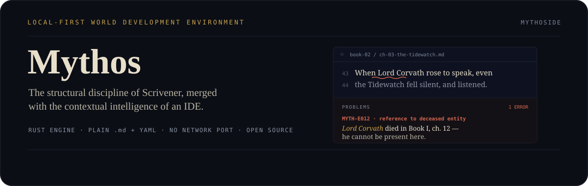

  

  <a href="https://mythoside.com">mythoside.com</a> · <a href="./README.md">English</a> · Türkçe

Mythos, uzun kurgu için, çoğunlukla bir seri yazanlar için bir masaüstü uygulaması. Kitaplar, bölümler, karakterler, mekânlar ve zaman çizelgesi notları kendi diskindeki klasörlerde, YAML frontmatter'lı düz Markdown dosyaları olarak yan yana durur. Uygulama hepsini birlikte okur; bir karakterin hangi bölümlerde geçtiğini bilir.

> **Erken geliştirme aşamasında.** Motor ve masaüstü uygulaması çalışıyor. Sıradaki iş süreklilik kontrolleri: örneğin Birinci Kitap'ta ölen bir karakterin İkinci Kitap'ta yeniden konuşmasını yakalamak.

## Repolar

| Repo | Ne işe yarar |
| --- | --- |
| [`mythoside-core`](https://github.com/mythoside/mythoside-core) | Rust ile yazılmış motor. Dosyalarını okur, yazar ve uygulamayla stdin/stdout üzerinden konuşur |
| [`mythoside-ts`](https://github.com/mythoside/mythoside-ts) | İçinde yazdığın masaüstü uygulaması. Tauri, React ve TypeScript |
| [`mythoside-website`](https://github.com/mythoside/mythoside-website) | Ürün sitesi, [mythoside.com](https://mythoside.com) |

## Nasıl kurulu

- **Seri, kitap, bölüm.** Bir serinin yapısı hazır gelir. Bunun için bir taslak aracını ayarlaman gerekmez.
- **Asıl kaynak senin dosyaların.** Her şey herhangi bir editörde açabileceğin, yedekleyebileceğin ya da sürüm kontrolüne koyabileceğin Markdown ve YAML. Planlanan arama dizini de yalnızca bu dosyalardan yeniden kurulan bir önbellek olacak.
- **Ağ portu yok.** Motor uygulamanın alt süreci olarak çalışır ve yalnızca kendi stdin/stdout'u üzerinden konuşur. Bilgisayarındaki başka hiçbir şey ona ulaşamaz.

## Fiyat

Geliştirme süresince ücretsiz. İlk sürümle birlikte Mythos, bir yıllık güncellemeyi içeren tek seferlik bir satın alma olacak. Satın aldığın sürüm sonrasında da çalışmaya devam eder; bir yıl daha güncelleme almak isteğe bağlı. Kaynak kodu [FSL-1.1-ALv2](https://github.com/mythoside/mythoside-core/blob/main/LICENSE.md) ile açık kalır, yani kendin derlemek ücretsiz kalır.

## Katkıda bulun

- Hatalar ve fikirler: [motor issue'ları](https://github.com/mythoside/mythoside-core/issues) · [uygulama issue'ları](https://github.com/mythoside/mythoside-ts/issues)
- Sorular ve geri bildirim: [Discussions](https://github.com/mythoside/mythoside-core/discussions)
- Pull request'ten önce: [CONTRIBUTING.md](https://github.com/mythoside/.github/blob/main/CONTRIBUTING.md)

## İletişim

| Konu | E-posta |
| --- | --- |
| Genel sorular | hello@mythoside.com |
| Destek ve yardım | support@mythoside.com |
| Güvenlik raporları | security@mythoside.com |
| Basın ve medya | press@mythoside.com |
| Kariyer | jobs@mythoside.com |
| Hukuk | legal@mythoside.com |
| Sosyal ve topluluk | social@mythoside.com |

Güvenlik açıklarını herkese açık bir issue yerine özel olarak **security@mythoside.com** adresine bildir.
