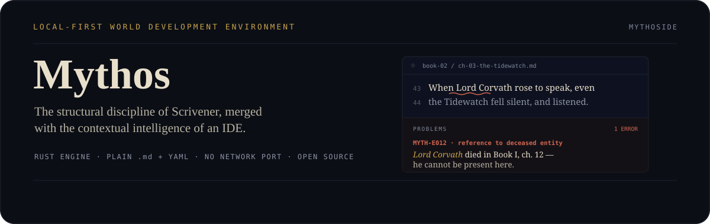

  

  <a href="https://mythoside.com">mythoside.com</a> · English · <a href="./README.TR.md">Türkçe</a>

Mythos is a desktop app for long fiction, usually a series. Books, chapters, characters and places live side by side as plain Markdown files with YAML frontmatter, in folders on your own disk. The app reads them together, so it knows which chapters a character appears in.

> **Early development.** The engine and the desktop app run. Continuity checks, such as catching a character who died in Book One speaking again in Book Two, are being built next.

## Repositories

| Repository | What it is |
| --- | --- |
| [`mythoside-core`](https://github.com/mythoside/mythoside-core) | The engine, in Rust. Reads and writes your files and talks to the app over stdin and stdout |
| [`mythoside-ts`](https://github.com/mythoside/mythoside-ts) | The desktop app you write in. Tauri, React and TypeScript |
| [`mythoside-website`](https://github.com/mythoside/mythoside-website) | The product site, [mythoside.com](https://mythoside.com) |

## How it is built

- **Series, book, chapter.** The structure of a series is built in. You don't configure an outliner to get it.
- **Your files are the source of truth.** Everything is Markdown and YAML you can open in any editor, back up or put under version control. A search index is planned, and it will only ever be a cache rebuilt from those files.
- **No network port.** The engine runs as a child process of the app and speaks only over its own stdin and stdout. Nothing else on your machine can reach it.

## Pricing

Free while in development. From version 1.0, Mythos is a one-time purchase that includes a year of updates. The version you bought keeps working after that, and renewing for another year is optional. The source stays public under [FSL-1.1-ALv2](https://github.com/mythoside/mythoside-core/blob/main/LICENSE.md), so building it yourself stays free.

## Get involved

- Bugs and ideas: [engine issues](https://github.com/mythoside/mythoside-core/issues) · [app issues](https://github.com/mythoside/mythoside-ts/issues)
- Questions and feedback: [Discussions](https://github.com/mythoside/mythoside-core/discussions)
- Before a pull request: [CONTRIBUTING.md](https://github.com/mythoside/.github/blob/main/CONTRIBUTING.md)

## Contact

| Reach us about | Email |
| --- | --- |
| General questions | hello@mythoside.com |
| Support and help | support@mythoside.com |
| Security reports | security@mythoside.com |
| Press and media | press@mythoside.com |
| Careers | jobs@mythoside.com |
| Legal | legal@mythoside.com |
| Social and community | social@mythoside.com |

Report security vulnerabilities privately to **security@mythoside.com**, not in a public issue.
